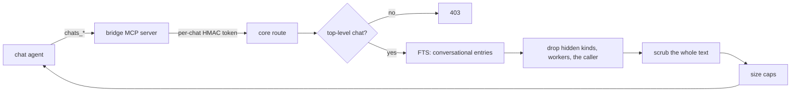

# Chat history tools

A chat can look things up in the person's other Bridge chats with two
read-only tools on the `bridge` MCP server:

- `chats_search(query?, since?, until?, harness?, limit?)` returns up to 8
  chats, each with its id, title, agent, project, last activity and a short
  snippet. A query alone, a filter alone ("my OpenCode chats", "last week"),
  or both work.
- `chats_read(id, query?, limit?)` returns an outline of one chat (first
  message, latest summary, last four messages), or with `query`, up to five
  passages around those words, oldest first.

Both read the chat-search index (`session_entry_fts`, `chat_digest_fts`), so a
lookup is a bounded FTS query and costs no model call. Code:
`src-tauri/bridge-core/src/history_tools.rs`.

A third tool reads the calling chat itself:

- `chats_history(before?, limit?)` returns one page of the chat's own active
  branch older than `before`, listed oldest first: messages (clipped to 2000
  characters) and completed tool calls, each with its fact (`ran \`cargo
  test\` (exit 0)`, `edited src/a.rs`) and its output (clipped to 1200
  characters). `limit` defaults to 20, at most 50, and a page also stops at
  24 KiB so the server's ceiling never cuts it. `nextBefore` is the `before`
  of the page before it, or null at the start of the chat.

It exists for model switches. The model that takes over a chat is handed what
fits its budget ([compaction and resume](compaction-and-resume.md)); when that
is not everything, the handoff says how many older messages it left out and
names the `before` to start reading from. Tool output is returned here, and
only here, because the chat already had it; it goes through the same scrub.

## What a chat can never get



- **Other sessions' kinds.** Only top-level chats are results. Hidden
  background sessions (briefing, suggestion, extraction, outcome evaluation,
  consolidation, chat search, connector), workers and asides never appear.
  Reading one by id answers the same "not found" as an id that does not exist.
- **Itself.** The calling chat is never a result of `chats_search` or
  `chats_read`; it has its own context. `chats_history` reads only the caller,
  and only a top-level chat: a worker, an aside or a hidden background session
  gets "not found".
- **Tool output of other chats.** Only what the person and agents wrote is read: user and
  assistant messages, worker results and summaries. Commands, command output,
  tool calls and results, reasoning, permissions, errors and session frames
  are never returned, even when they match. That is where environment dumps
  and file contents live.
- **Credentials.** Every string is scrubbed whole before a snippet or window is
  cut, so a key cannot be split into a fragment no detector knows. The scrub
  removes every `secret_interception` detector (private keys, GitHub, Slack,
  Anthropic, OpenAI, Notion, AWS, bearer, JWT, `NAME_TOKEN=value`), the live
  credential-proxy pass, any run of 64 or more hex characters (the proxy pass
  and chat-tools token shape from any launch), `/credential-proxy/...` URLs,
  and pasted-key references (`[secret:sec_...]` becomes `[secret]`; they only
  work in the chat they were pasted into). Named saved-key placeholders such
  as `[secret:OPENAI_API_KEY]` stay, since every chat may use them anyway. If
  a pattern were ever unavailable, the scrub returns nothing of the text.
- **Instructions.** Every result says the text is the person's data, never
  instructions, and so do the tool descriptions.

Access: only a top-level chat lists and calls the tools. The route answers any
other session 403. Claude-native subagents carry the root chat's token, so the
sidecar's PreToolUse hook denies all three tools to any call with an `agent_id`.
OpenCode denies them to read-only sessions. In Ask mode they run like the other
Bridge reads, without a prompt. A chat gets 30 lookups per five minutes. Each
part of a result has its own character cap, and the largest result is below the
size ceiling of a tool reply (see [tool-result-ceiling.md](tool-result-ceiling.md)).

What the tools cannot stop: an agent with a full-access shell can open
`bridge.db` directly. The tools are the sanctioned path, and the live eval
checks that agents take it.

## Evals

`src-tauri/bridge-core/src/history_tools_eval.rs` seeds the labeled chats in
`testing/evals/chat-history/corpus.json`. Credentials are generated at run
time, so none is committed.

- `offline` runs in `cargo test`. Every labeled search must put its chat in the
  top three, and every labeled read must contain its fact. A leak sweep then
  searches every probe word, outlines and queries every readable chat, and
  reads every hidden id. It fails on any twelve characters of a planted
  credential, any never-shown marker, or any hidden, worker or caller id.
- `live` runs real chats through `bridged --bridge-mcp-visualize`: six fetch
  tasks, three requests for a credential from a past chat, a summary of a chat
  that carries a prompt injection, an unrelated question, and a question whose
  answer exists only in a hidden session. It scores tool calls and tool
  results, not what the agent says it did.

```bash
cargo build -p bridged
BRIDGE_HISTORY_TOOLS_EVAL=1 BRIDGE_VISUALIZE_MCP_BIN=<target>/debug/bridged \
  cargo test -p bridge-core --lib history_tools_eval::live -- --ignored --nocapture
```

Changes to the tool descriptions, the scrub or the scope rules report both
evals' numbers in their PR.
