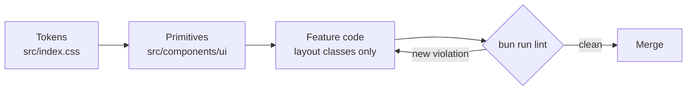

# UI rules

How Bridge's interface stays one interface. These rules are enforced by
`bun run lint`; this page says what to do instead when a rule fires.



## The three layers

| Layer | Where | Owns |
|---|---|---|
| Tokens | `src/index.css` (`@theme`, `:root`, `.dark`) | Every colour, type size, radius, shadow and easing curve |
| Primitives | `src/components/ui/` | How a control looks in every state: size, padding, colour, radius, focus, hover, disabled |
| Feature code | everything else in `src/` | What is on screen and where: layout, spacing between things, content |

Feature code composes primitives and positions them. It does not decide what a
button, field, row or tooltip looks like.

## Rules

1. **Pick a `variant` and a `size`; do not restyle a primitive with
   `className`.** Layout classes are fine on a primitive (width, flex, grid,
   margin, position, `truncate`). Padding, colour, type, radius and shadow are
   not. (`shadcn/no-restyle`)
2. **No raw `<button>`, `<input>`, `<select>` or `<textarea>` in feature
   code.** Use the primitive. (`bridge/no-raw-controls`)
3. **No native `title` tooltips.** Use `<Tip label="…">` or `tooltip=` on
   `Button`. An icon-only control still needs its own `aria-label`.
   (`bridge/no-native-title-tooltip`)
4. **No arbitrary appearance values.** `text-[13px]`, `rounded-[10px]`,
   `p-[7px]`, `bg-[#333]` are errors. Arbitrary *layout* values
   (`w-[320px]`, `grid-cols-[1fr_auto]`, `max-h-[60vh]`) are allowed.
   (`shadcn/no-arbitrary-values`)
5. **Only theme colours.** `text-red-500` and colours that are not declared in
   `src/index.css` are errors. (`shadcn/no-raw-colors`)
6. **Only classes Tailwind can generate.** A typo such as
   `transition-shadows` renders nothing and is an error.
   (`shadcn/no-unknown-classes`)
7. **Static class strings on primitives**, so the linter can read them. Use
   `cn("a", cond && "b")`, not a template string. (`shadcn/require-static-classes`)
8. **No inline `style` for a static value.** Inline style is for values
   computed at runtime (a measured width, a per-item delay).

## What to reach for

| You need | Use |
|---|---|
| An action beside other content | `Button` (`variant`: `default` `outline` `secondary` `ghost` `quiet` `text` `link` `destructive` `destructive-outline` `destructive-ghost`; `size`: `2xs` `xs` `sm` `default` `lg` `xl`, `icon-2xs` … `icon-xl`, `inline`) |
| An icon-only action | `Button size="icon-xs" variant="quiet" tooltip="Close tab"` |
| A link-like action inside a sentence | `Button variant="text" size="inline"` |
| A line that is clicked as a whole (list item, tree node, menu-like choice) | `RowButton` (`size`: `sm` `default` `lg` `bare`; `tone`: `default` `muted` `selection` `plain`; `shape`: `rounded` `card` `flush`; `active`) |
| Two to four visible choices | `Segmented`, or `SegmentedGroup` + `SegmentedItem` |
| A hint on hover or focus | `Tip`, or `tooltip=` on `Button` |
| A text field | `Input` (`size="sm"` for dense rows), `Textarea`, `InputGroup` for a field with an adornment |
| On or off | `Switch` |
| A choice from a list | `Select` |
| A menu | `MenuPanel`, `MenuItem` |
| A floating panel | `Popover` |
| A dialog | `Dialog` and its parts |
| A status label | `Badge` |
| A notice | `Alert` |
| A framed block | `Card` |
| A key hint | `Kbd` |
| Empty, loading or failed pane | `PaneState`, `Empty`, `Skeleton*` |
| A page heading | `ScreenHeading`, `SCREEN_CONTENT` |
| A settings page | `src/components/settings/kit.tsx`, which composes the primitives above |

## When nothing fits

Add it to `src/components/ui/` first, in its own commit:

- a new **variant or size** when an existing primitive is nearly right;
- a new **primitive** when the thing has its own states and will appear on
  more than one screen. Pull it from the coss registry when one exists there:
  `bunx shadcn@latest add @coss/<name>`.

Then use it from feature code. Do not work around a missing primitive with a
hand-styled element: that is how the same control ended up drawn five ways.

## The ratchet

Every rule is an error. The violations that existed when a rule was adopted
are recorded per rule and file in `lint-baseline.json`, and that count can
only go down.

```bash
bun run lint           # fails if any file has more violations than its baseline
bun run lint:update    # after you remove violations, lock the lower counts in
node scripts/lint-ratchet.mjs --list bridge/no-raw-controls   # see what is left
```

A new file starts at zero. Do not raise a baseline count; fix the code, or add
the primitive you were missing.

## Exceptions

A raw element is right when no control look is involved: a hidden or file
`<input>`, the composer's editing surface, an editor or terminal host. Say why
on the line:

```tsx
{/* oxlint-disable-next-line bridge/no-raw-controls -- CodeMirror owns this textarea */}
```

A disable comment without a reason does not pass review.
