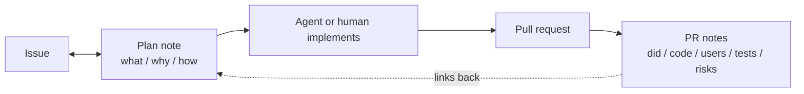

# PR format: a plan note before the code, PR notes after it

Every pull request in this repository goes through the same two notes. The
first is written before any code and says what is being built and why. The
second is the PR body and says what actually happened. A reviewer should be
able to judge the change from the two notes without opening the diff first.



## 1. The plan note (before code)

Written as soon as the work is picked up, before the first edit. In Bridge it
is a Bridge note; outside Bridge it is a comment on the issue.

| Section | Contains |
|---|---|
| **What** | The change, in a few lines. Scope and what is out of scope. |
| **Why** | The problem it solves, with a Mermaid diagram of the mechanism or flow. |
| **How** | Files, symbols and steps, plus the tests that will prove it. |

The plan note is two-way. The person edits it as freely as the agent does, and
the agent re-reads it before coding and again before opening the PR. When the
two disagree, the person's edit wins.

## 2. The PR notes (the PR body)

Start from [`.github/PULL_REQUEST_TEMPLATE.md`](../.github/PULL_REQUEST_TEMPLATE.md).
Link the plan note and the issue at the top, then fill five sections:

| Section | Contains |
|---|---|
| **What I did** | The change as built, which can differ from the plan. Say where it did. |
| **Codebase affected** | Crates, modules, files, wire methods, migrations, workflows. |
| **Users affected** | Who notices, on which surface or platform, and what they see. "No user-facing change" with the reason is a valid answer. |
| **Tests I ran** | Each command and its output, pasted unedited in a fenced block. Name what you did not run and why. |
| **Tradeoffs and risks** | What was given up, what could go wrong, and how someone would notice. |

UI changes also carry a `## Screenshots` section with dark, light and one
interaction state.

In Bridge, the agent also saves the PR notes as a Bridge note under the plan
note, so the pair stays together after the PR merges.

## How the gate works

The **PR notes** job in
[`.github/workflows/pr-title.yml`](../.github/workflows/pr-title.yml) runs
[`scripts/pr-format.mjs`](../scripts/pr-format.mjs) on every PR open, push,
edit and label change. It fails when:

- any of the five headings is missing (`##` or `###`; emoji, case and trailing
  colons are tolerated),
- a section has fewer than 20 characters of real content (HTML comments, empty
  checkboxes and `TODO`/`TBD`/`N/A` do not count),
- `Tests I ran` has no non-empty fenced code block.

Headings inside fenced output do not split a section, and `###` subsections
stay inside their parent. Drafts are skipped until they are marked ready.

Check a body locally before opening the PR:

```bash
node scripts/pr-format.mjs body.md
gh pr view 123 --json body -q .body | node scripts/pr-format.mjs
```

The rule is tested by
[`scripts/test/pr-format.test.mjs`](../scripts/test/pr-format.test.mjs) under
`bun run test`.

## The escape hatch

PRs opened by bots (Release Please, Dependabot) are exempt automatically. For
anything else that genuinely does not fit, add the `format-exempt` label or put
`<!-- pr-format: exempt -->` in the body.
