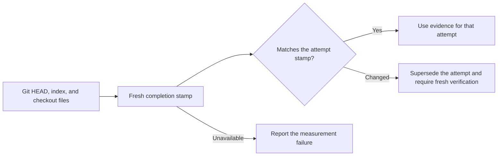

# Completion Proof Content Stamp Implementation Plan

> **For agentic workers:** Use superpowers:executing-plans to implement this plan task by task. Track progress with the checkboxes below.

## What

**Goal.** Bind each completion attempt, its evidence, and its revision-scoped waivers to the contents of the Git checkout Bridge evaluates.

**Architecture.** Add a typed, uncached measurement for completion. It combines Git HEAD, the index, and the actual tracked and non-ignored untracked files. Completion callers measure outside the core database lock and recheck the attempt identity before applying the observation.

**Tech stack.** Rust, Git, SQLite, and the existing `sha2` dependency.

**Spec.** [Bridge issue #543](https://github.com/Atharva-Kanherkar/bridge-harness/issues/543).

## Why

`store::measure_repository_state` hashes the output of `git status --porcelain=v1 -z --untracked-files=all`. I reproduced identical output and digests for two different edits to a modified tracked file, two staged versions of a tracked file, and two versions of an untracked file. The previous check and waiver API also substituted the stored attempt stamp when Git could not read the checkout. That fallback made the freshness comparison succeed without a current observation. [Porcelain measurement](../../../src-tauri/bridge-core/src/store.rs#L3563), [Previous API fallback](https://github.com/Atharva-Kanherkar/bridge-harness/blob/35cf95b6c5f49ca681d729c8edc1243f6bb911be/src-tauri/bridge-core/src/api.rs#L4646).

Hashing Git patches would read less on clean trees. Patches depend on Git's comparison and normalization, and still need a separate source for untracked bytes. I recommend measuring the file bytes because verifiers run against the materialized checkout. This costs a read of each included file at a verification boundary. The transcript's cached repository hint has a separate latency budget. [Transcript stamp cache](../../../src-tauri/bridge-core/src/repo_stamp.rs#L1).

## How

### 1. Measure the checkout

Create `src-tauri/bridge-core/src/completion/repository_stamp.rs`, exposed through `completion::repository_stamp(path: &Path) -> Result<RepositoryStamp, BridgeError>`. Reuse the existing `RepositoryStamp { head, dirty_digest }` fields. Use `sha256:v2:<64 lowercase hex digits>` for the new digest so legacy porcelain hashes compare as a different version.

- [x] **Write the Git regressions.** Use real temporary repositories and same-length writes. Assert that HEAD and porcelain bytes stay equal while the stamp differs for two unstaged versions, two versions staged at the same path, and two untracked versions. Include a staged-only change with fixed worktree bytes and a worktree-only change with a fixed staged blob. Assert repeatable clean and dirty stamps across invocations and when measuring the same checkout from a subdirectory.
- [x] **Run the regressions against the existing stamp.** Run `cargo test --manifest-path src-tauri/Cargo.toml --locked -p bridge-core --lib completion::tests::completion_stamp`. The same-path cases should fail on digest equality before changing the algorithm.
- [x] **Implement the measurement.** Resolve the actual worktree root and HEAD. Read the NUL-delimited index entries with `git ls-files --stage -z` and untracked paths with `git ls-files --others --exclude-standard -z`. Hash index entries by root-relative path, stage, mode, and full object ID. Hash the sorted union of tracked and untracked paths by raw path bytes and file state. Use length-prefixed records with distinct tags for each section and file kind. Stream regular file bytes into per-file hashes and include executable bits where supported. Represent missing paths and directories explicitly, and hash symlink targets through `read_link`. Keep filesystem traversal rooted and avoid following symlinks in parent path components. Use Git's read-only command wrapper and propagate errors and output limits.
- [x] **Cover Git and filesystem edge cases.** Assert changes for binary files, deletion, executable-bit changes, symlink retargeting, and edits to a file marked assume-unchanged. Exercise a linked worktree with a different index and confirm that measuring from its subdirectory returns the linked worktree's stamp. Assert that editing an ignored file or a symlink's external target leaves the stamp equal. Include a filename with a newline and a non-UTF-8 Unix filename. For tracked submodules, hash the index gitlink and the initialized child's HEAD and checkout digest, with an explicit state for an uninitialized checkout. Refuse opaque directory entries or special files that cannot be measured safely. Verify HEAD and the Git inventories again after reading and detect files changed during the scan using file identity and metadata checks. Report detected drift as retryable without returning a partial stamp.
- [x] **Re-run the focused regressions.** Expect all stamp tests to pass, including stability for the same index and file contents. Confirm the measurement leaves the real index and worktree bytes intact.

### 2. Require a current stamp for checks and waivers

Update `completion.rs` for worker and orchestrator gate creation, worker result settlement, and the shared stamp comparison used by finalization and waivers. Update `api.rs` for manual plans, check results, and waivers. Update `live_turn.rs` and `check_runner.rs` for background checks and verification worker launch and settlement. [Completion finalization](../../../src-tauri/bridge-core/src/completion.rs#L2077), [manual completion APIs](../../../src-tauri/bridge-core/src/api.rs#L4651), [background check maintenance](../../../src-tauri/bridge-core/src/live_turn.rs#L11568).

- [x] **Write the gate regressions.** Create an attempt over a dirty file, grant a partial waiver, edit the same file again, and assert that finalization supersedes the old attempt. Assert that the waiver gives no coverage to the new attempt and that a new waiver against the stale attempt is rejected. Delete or make a regular attempt's checkout unreadable and assert that the manual check and waiver paths return a measurement error and write neither passing evidence nor a waiver.
- [x] **Run the focused gate tests.** Expect the changed-checkout and unavailable-checkout cases to fail through their real entry points before rewiring the callers.
- [x] **Route every completion caller through the new measurement.** Resolve the checkout and attempt under the database lock, measure outside the lock, then confirm the attempt ID, path, and eligible status before recording evidence. Drop the API's stored-stamp fallback. Check the stamp before launching a background check and again before crediting the outcome. Leave a clear diagnostic and a retry or deadline path if a scan fails. Keep the explicit human override for a gate-creation error scoped to its system `gate-error` check. An override when the checkout is unavailable may release the parent, with no repository proof bundle.
- [x] **Pin asynchronous verifier results.** Measure the checkout before binding each verification worker to the attempt ID at launch. Add a nullable `verification_attempt_id` to `worker_completion_inputs` and copy it to the durable outbox entry when the worker reports. At settlement, require the original binding and a fresh matching stamp before recording results or findings. Assert that a late worker cannot settle a replacement attempt on the same path, including after the worker session is reused. An in-flight legacy verifier without a binding requires a fresh run.
- [x] **Verify compatibility.** Keep historical proof and waiver rows readable. On the next use that requires current evidence, a legacy digest fails the versioned comparison and requires a fresh attempt. Leave wire types intact. Run the completion, check-runner, and relevant API tests.

### 3. Prevent stale proof from following adopted work

Update `worker_adoption::integrate` and its fixtures to measure the worker checkout before capture. After a fast-forward, compare the adopted files with the measured source contents. This comparison excludes the worktree root and index so that capturing a commit can change Git metadata. A content mismatch or unavailable measurement takes the existing proof-superseding path. [Worker adoption](../../../src-tauri/bridge-core/src/worker_adoption.rs#L617).

- [x] **Extend the adoption regression.** Edit an already-dirty worker file after recording its attempt. Assert that porcelain stays equal, adoption still integrates the edited bytes, and the attempt becomes `superseded`. Pair it with the unchanged dirty worker case, which should keep its proof.
- [x] **Run the adoption tests before and after rewiring.** Run `cargo test --manifest-path src-tauri/Cargo.toml --locked -p bridge-core worker_adoption::tests`. Expect the same-path case to fail with the old measurement and both cases to pass with the new one.
- [ ] **Run the repository gates before opening a PR.** On THINKBOOK, run `bun run build` and `bun run test` sequentially under `ai.slice`. When outside `ai.slice`, prefix each focused or full command with `/home/ayushparihar/.local/bin/agent-run`.

## Review focus

- A staged change with identical working bytes, or a working change with the same staged blob, must invalidate proof. Task 1 pins both.
- A linked worktree with a subdirectory as the session cwd must measure its own root and index. Task 1 pins that checkout identity.
- A Git or file read failure must leave completion without fresh evidence. Task 2 pins API failures and keeps an unavailable background check eligible for the existing deadline.
- Git may issue a warning and succeed with a partial inventory. Task 1 exercises an unreadable directory. Task 2 preserves the explicit human override for legacy gate-creation failures.
- A late verifier must never move its result to a newer attempt. Task 2 pins the attempt binding and the legacy case.
- Adoption may preserve proof only if the destination contains the verified bytes. Task 3 pins changed and unchanged dirty checkouts and the case where Git skips a tracked file marked assume-unchanged.

This plan measures a live checkout at verification boundaries. Edits made and reverted entirely between observations would require an isolated verification snapshot to detect.

## Verification on THINKBOOK

- The original implementation failed all six focused regressions. The final build passed 114 focused Rust tests, including completion, worker adoption, and database migrations.
- `bun run build` passed. The release scripts and both sidecar suites passed. Vitest passed 5,338 tests and skipped five.
- `bun run test` stopped at the stale checked-in `src/mcp-apps/visual/generated/visual.html`. The Rust workspace compiled, then reported failures in automation file permissions, executable discovery, and capability discovery. All three failed again on the unmodified baseline binary. The workspace run was stopped after the failures were recorded.
