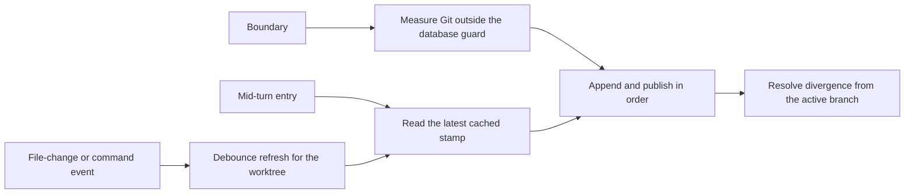

# Forest repository stamps implementation plan

**Goal**

Finish [issue #1042](https://github.com/Atharva-Kanherkar/bridge-harness/issues/1042) by taking exact Git stamps at conversation boundaries and removing Git from the locked forest write path.

**Architecture**

Resolve the session's repository location with a short database read, sample Git outside the lock when a boundary needs it, and pass the result into the existing append transaction. Mid-turn writes read the existing per-worktree cache. Forest snapshots use the active parent chain to find the boundary stamp that divergence should compare.

**Tech stack**

Rust, rusqlite, Git, the existing bridge-core fixture suite, and the latency ledger from [#1037](https://github.com/Atharva-Kanherkar/bridge-harness/issues/1037).

## What

Finish the stamp cache work that landed in PR #1130. Preserve the `_bridgeRepoState` format, the append-only forest, persist-before-publish ordering, and the existing divergence response. Keep the change within forest stamping and the reads that report its divergence. [Parent epic #1036](https://github.com/Atharva-Kanherkar/bridge-harness/issues/1036) · [PR #1130](https://github.com/Atharva-Kanherkar/bridge-harness/pull/1130)

## Why

`repo_stamp::for_entry` still falls back to Git on a cold, old, or invalidated cache while `store::append_session_entry_tx` holds a transaction. Its one-second reuse window can also miss a filesystem edit at a boundary. The compaction controller separately measures its retained boundary inside the transaction. PR #1130's existing fixture reported p95 lock holds of 0.56–1.5 ms and a worst lock hold of 101 ms. The remaining work is to remove those fallbacks and make boundary freshness explicit. [PR #1130 measurements and tradeoffs](https://github.com/Atharva-Kanherkar/bridge-harness/pull/1130)



## How

### 1. Characterize the behavior and record a baseline

- [ ] Add a real temporary Git repository fixture in `src-tauri/bridge-core/src/sessions.rs`. Assert that an unchanged repository is `aligned`, a worktree edit between turn boundaries is `diverged` until the next freshly stamped boundary, and a clean commit can cause divergence even when the dirty hash is unchanged. Assert `unknown` for an unborn repo, a scratch chat, and a selected legacy boundary without a stamp.
- [ ] Run the characterization before the implementation and keep its outcome assertions through the change. For the baseline, use the existing tool invalidation path to make the next message observe a change deterministically. Use `repository_stamps_detect_clean_dirty_and_conversation_rewind_divergence` in `src-tauri/src/lib.rs` and the scratch and unborn fixtures in `store.rs` as existing coverage. Add the within-cache-window, unreported edit as a regression test in step 2, since the current implementation can miss it.
- [ ] Extend the existing ignored `perf_bench::perf_bench_concurrent_chat_streams` workload in `src-tauri/bridge-core/src/perf_bench.rs` before editing the stamping code. Use disposable repos populated with a fixed many-untracked-files workload. Run cold and warm samples with both shared and distinct worktrees, retaining the streaming workload and including normal boundary frames and bursts of file changes. Record the workload, sample counts, Git starts, and p50/p95/p99 for Git preparation, lock wait, lock hold, and total persistence. Capture the baseline from the current checkout with the same workload used for the final run.

### 2. Prepare stamps outside the lock and make the write path cache-only

- [ ] In `src-tauri/bridge-core/src/store.rs`, separate reading the raw session location from resolving the guarded worktree path and measuring Git. Read the cwd-first SQL value and the database path under a short guard. Perform filesystem discovery and existing scratch/home protection afterward. Preserve explicit Git repositories initialized in scratch chats, cwd aliases, and the early return when `rev-parse HEAD` fails. Keep the current `HEAD` and porcelain dirty hash algorithm.
- [ ] In `src-tauri/bridge-core/src/repo_stamp.rs`, replace the age-based exact reuse and the `for_entry` fallback with an explicit prepared boundary stamp and a cache-only lookup for other rows. The prepared value carries the observed session location so the writer can check that the cwd or workspace path still matches. Reprepare outside the guard if the binding changed. A cold mid-turn write completes with the existing unavailable marker. Key cache slots by resolved worktree so sessions in subdirectories can share observations and linked worktrees keep independent state.
- [ ] Move the boundary decision to the call sites that know what will persist. In `live_turn.rs`, use the normalized durable event kind for provider frames, gathering any routing facts needed for normalization under a short read and keeping launch, turn and authority rechecks in the existing write section. Use one fresh observation per boundary batch for a worktree. Prepare `user.message` at `deliver_prepared_input`, `hold_input`, and question answers before provider delivery or queue mutation as applicable. Reuse the observation across the corresponding append. If the repository binding changes after delivery, retry observation and persistence without redelivering the input. Audit all production callers of the normalized and typed append paths in `store.rs` and `session_forest.rs` for synthetic boundary writers.
- [ ] Preserve `assistant.message` and `turn.failed` as exact kinds because the existing cache treats them as return points. Include `user.message`, `turn.completed`, `checkpoint`, `compaction`, `branch.summary` and native `context.compacted` in the same boundary predicate. The store consumes a prepared stamp for these live entries and reads cached data for other kinds.
- [ ] Replace `refresh_before_lock` on every frame with a bounded debounced refresh per worktree. Mark file-change events and `command.completed` as invalidations and preserve existing tool-completion and editor-save signals. Schedule the refresh after a committed event, release the cache lock during Git, and retain the last sample while it runs. Use the existing generation scheme with a measurement order so an older completion cannot overwrite a newer boundary sample. An invalidation arriving during a scan leaves one follow-up refresh pending. Start with a 250 ms debounce and verify it against the fixture.
- [ ] Use the Git process counter in `git.rs` with a test-only, thread-local scope covering the calling thread's database guard or transaction. Check the production write seams for zero locked Git starts on a cold cache, after an idle interval, during a file-change burst, and on every boundary route. Verify independently that an edit made without a Bridge event inside the old one-second reuse window appears in the next boundary stamp. Use a controlled clock and a paused refresh to verify burst coalescing, distinct worktrees, stale-result rejection, and a changed session location.

### 3. Keep compaction and divergence accurate

- [ ] Thread the prepared stamp through `CompactionController::handle_output`, `record_checkpoint`, and `record_switch_checkpoint` in `src-tauri/bridge-core/src/compaction_controller.rs`. Prepare it at the live-reader, detached switch-summary, and reconstruction callers. Recheck the pending request, head, and launch inputs at the existing correctness gates. Reuse one measurement for the checkpoint, compaction record, and retained branch summary written in the same transaction. Assert that all three match an independent fresh read and still commit or roll back together.
- [ ] In `src-tauri/bridge-core/src/sessions.rs`, use the selected boundary's stamp directly. For a mid-turn head, follow `parent_entry_id` to the nearest stamped boundary in the same session, even if the requested page excludes that row. Use the active branch relationship and stop as soon as a qualifying row is found. Treat an explicit unavailable boundary stamp as `unknown`, and return `unknown` when no usable anchor exists. Cached mid-turn markers remain storage metadata. The lookup uses the same kind rule for existing and new mid-turn rows, with no history rewrite or wire field.
- [ ] Reuse the off-lock current-state pattern in `api::get_session_forest` for activate/rewind and fork snapshots, which currently call `session_forest_snapshot` under the guard. For a shared fork use the source location. For an isolated fork use the new worktree and keep its existing failure cleanup. Keep head updates and event publication in their existing serialized sections. Make the production database-only snapshot path require a supplied current state.
- [ ] Verify a one-entry snapshot resolves a boundary outside its page, a sibling with a newer sequence is ignored, the first unstamped branch yields `unknown`, and rewind and fork compare against the correct worktree. Assert no locked Git starts for compaction, rewind, and fork snapshot assembly. Run the existing `context.rs` and `session_supervisor.rs` coverage for stripping `_bridgeRepoState` before model context is built.

### 4. Verify the latency target

- [ ] Run the focused bridge-core and bridge-deck fixtures and the repository's `bun run build` and `bun run test` before opening a PR. On THINKBOOK, launch coding workloads through `agent-run` when outside `ai.slice`, with one heavy suite at a time.
- [ ] Repeat the ignored fixture benchmark on the same machine, workload, and build profile. Report total persistence and lock timings, with the fresh boundary sample cost broken out. On THINKBOOK, set `BRIDGE_PERF_REPOS` to the colon-separated scratch worktrees for both runs and use this command.

  ```sh
  agent-run cargo test --manifest-path src-tauri/Cargo.toml --locked -p bridge-core \
    --lib perf_bench::perf_bench_concurrent_chat_streams -- --ignored --exact --nocapture --test-threads=1
  ```

- [ ] Use the read-only `node scripts/latency-report.mjs --data-dir <bridge-data-dir>` with comparable before and after windows on the measured install. Verify `bridge.persist_gap_same_frame` p95 is at most 5 ms and record sample counts. That metric covers adjacent persisted entries derived from one Claude frame, so report synchronous boundary overhead from the fixture and the clean-daemon latency experiment as well. Include before/after output in the PR.
