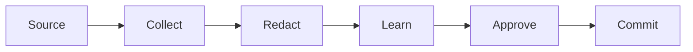

# feat/visuals-fullscreen — Test Contract

## Functional Behavior

Every visual block the transcript renders can be opened fullscreen, because a
diagram sized to fit a chat column is often unreadable (Mermaid especially).

Covered block kinds, all in `src/components/Markdown.tsx`:

| Block | Renderer | Today | After |
| --- | --- | --- | --- |
| ` ```diagram ` | `DiagramBlock` → `DiagramFigure` | copy only | copy + fullscreen |
| ` ```mermaid ` | `MermaidBlock` | copy only | copy + fullscreen |
| ` ```html ` | `HtmlBlock` | fullscreen already | unchanged: it keeps its own overlay |

Display math (`$$…$$`) is deliberately out of scope: KaTeX sets its own font
size, so a wider overlay does not make an equation any larger; its existing
horizontal scroll is the right affordance.

Rules:

- The affordance is a button labelled `Fullscreen` (visible text `Expand`,
  `Maximize2` icon), in the block's hover toolbar next to `Copy`.
- Clicking it portals a dialog to `document.body` with
  `role="dialog"` and `aria-label="<kind> fullscreen"`.
- The overlay shows the visual alone at the overlay's width (100% zoom), not the
  chat column width, with a caption still visible for diagrams. The shared
  overlay covers `diagram` and `mermaid`; `html` already had its own, which this
  change leaves alone.
- Zoom control: `Zoom out`, a live percentage, `Zoom in`, clamped to 50–300% in
  25% steps. 100% = fit the overlay width. Zooming past the overlay width
  scrolls, it never clips.
- `Exit fullscreen` (and `Escape`) closes the overlay and restores the inline
  block.
- Nothing about the inline render changes: same markup, same copy behaviour.
- Invalid diagram JSON still falls back to source, never crashes.
- Zoom resets to 100% the next time a block is opened.

Non-goals: display math (see above), image `` rendering (Bridge's markdown
has none), a second fullscreen surface for code blocks.

## Unit Tests

`src/components/VisualFullscreen.test.tsx` (new):

- `zoomClamp` / `nextZoom` helpers clamp at 50 and 300 and step by 25.
  (Exported pure helpers, tested without mounting.)
- Renders nothing when `open` is false.

`src/components/Markdown.test.tsx`:

- `renders a fullscreen affordance for diagrams` — static markup contains
  `aria-label="Fullscreen"` for a `diagram` fence and a `mermaid` fence.
- Interactive: clicking `Fullscreen` on a diagram opens
  `[role="dialog"][aria-label="diagram fullscreen"]` outside the message
  container, and `Exit fullscreen` closes it.
- Interactive: zoom buttons change the displayed percentage, clamp at 50/300.

## Integration / Functional Tests

- `bun run build` (tsc + vite) stays green.
- `bunx vitest run src/components/Markdown.test.tsx src/components/DiagramFigure.test.tsx src/components/VisualFullscreen.test.tsx`.

## Smoke Tests

- `bun run dev` — a message with a wide ```` ```mermaid ```` fence shows Expand on
  hover; expanding shows the diagram at window width with legible labels.
- Esc closes the overlay; the message underneath is unchanged.

## E2E Tests

N/A — the app has no end-to-end harness; the interactive Vitest cases above
cover the open/close/zoom transitions.

## Manual / cURL Tests

N/A — no network surface. Visual check: paste this into a Bridge chat reply and
open it fullscreen:

````

````
