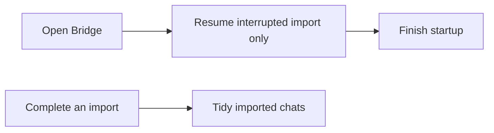

# fix-disable-startup-import-cleanup — Test Contract

## Functional Behavior

- Opening Bridge does not spawn imported-chat cleanup or delete/file existing imported chats.
- Interrupted import recovery remains enabled.
- Completing an import still tidies imported background runs and files real chats under projects.
- No schema or protocol changes.

## Unit Tests

- Startup maintenance with no pending import preserves an imported Bridge background run and leaves a real imported chat without a workspace.
- Existing explicit tidy coverage still removes background runs and files chats.
- Existing import recovery and completion tests pass.

## Integration / Functional Tests

- The bridged workspace tests continue to verify startup and client handshakes.

## Smoke Tests

- Rebuilt daemon becomes reachable on this Mac's existing data directory without the startup tidy worker.

## E2E Tests

N/A — no new UI journey; daemon smoke and existing workspace coverage exercise startup.

## Manual / cURL Tests

Run `bun run tauri dev`; verify no 30-second daemon timeout and no bridge-import-tidy thread during idle startup.

## Plan note

# Plan: disable imported-chat cleanup during startup

Issue: none — reported in this session.

## What

Stop spawning the imported-chat tidy worker when Bridge opens. Keep interrupted-import recovery and cleanup after an import completes.

## Why

A live macOS process sample showed bridge-import-tidy using a CPU core in import_placement::purge_background while the desktop main thread waited on core.db in start_queued_input_maintenance. The same worker starts before the daemon becomes ready, causing its 30-second timeout. Cleanup batches can hold the shared database for minutes on large histories.

## How

- Remove the startup tidy thread from import_job::start_import_maintenance; document the database-lock reason.
- Add a regression test that seeds an old imported background run and a real unfiled chat, runs startup maintenance with no pending import, waits for its workers to settle, and verifies both rows remain untouched.
- Keep explicit tidy and import-completion coverage; rename the old startup-labelled test to describe explicit tidying.
- Verify the regression fails before the fix, then run bun run build and bun run test. Rebuild the daemon and verify a real startup becomes reachable without modifying imported history through cleanup.
- No schema, protocol, frontend, or Linux-warning changes.
